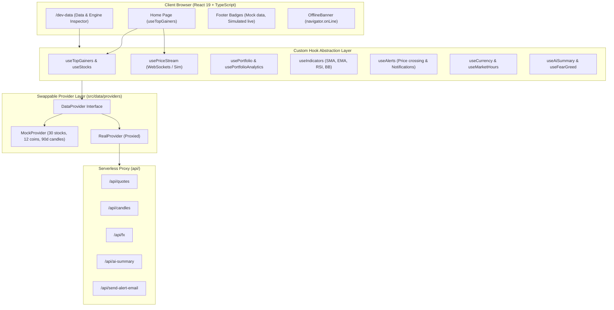

# StockPulse — Minimalist Market Dashboard

StockPulse is a calm, data-first stock and cryptocurrency dashboard tailored for retail investors and students. It highlights **rising prices first**, maintains strict typographic hierarchy with Inter and JetBrains Mono, and is built on a typed, token-driven design system with swappable data providers.

> **Disclaimer:** Demo project with simulated mock data. Not financial advice.

---

## Architecture Diagram



---

## Swapping in a Real API

StockPulse uses a clean provider pattern (`src/data/providers/types.ts`). To switch between mock simulation and live feeds:

1. **Change the Data Provider flag**:
   In `.env.local` (or production environment variables), set:
   ```env
   VITE_DATA_PROVIDER=real
   ```
   When set to `real`, `RealProvider` routes quote, candle, AI, and FX requests through the `/api/*` serverless proxy.

2. **Configure Server-Side Secrets**:
   Set API keys only in your server environment (e.g., Vercel Project Settings or local `.env`):
   ```env
   COINGECKO_API_KEY=your_coingecko_key
   STOCKS_API_KEY=your_alphavantage_or_finnhub_key
   LLM_API_KEY=your_gemini_or_openai_key
   RESEND_API_KEY=your_resend_api_key
   ```
   No API keys are ever bundled or exposed in client-side code.

3. **Switch to Public WebSocket Stream**:
   To stream live real-time crypto trades instead of the simulated random walk drift:
   ```env
   VITE_STREAM_PROVIDER=binance
   ```
   `BinanceWebSocketStream` auto-connects to public Binance trade streams with automatic exponential backoff reconnection.

---

## Serverless Proxy Setup (`/api`)

The proxy layer runs as Vercel serverless functions in production and via Vite dev middleware in local development:

| Endpoint | Method | Purpose | Cache TTL | Rate Limit |
| :--- | :---: | :--- | :---: | :---: |
| `/api/quotes` | GET | Quotes, gainers, fear/greed, trending | 30s | 30 req/min |
| `/api/candles` | GET | 90-day OHLC candlestick series | 5 min | 30 req/min |
| `/api/fx` | GET | USD / INR exchange conversion | 5 min | 30 req/min |
| `/api/ai-summary` | GET | Summaries from headlines and price context | 5 min | 30 req/min |
| `/api/send-alert-email`| POST | Resend alert email notification | None | 30 req/min |

All routes validate input schemas with Zod and enforce IP rate limiting.

---

## Quantitative Calculation Engines (`src/lib`)

- **Technical Indicators** (`src/lib/indicators.ts`):
  - `calculateSMA(candles, period)`
  - `calculateEMA(candles, period)`
  - `calculateRSI(candles, period = 14)`
  - `calculateBollingerBands(candles, period = 20, multiplier = 2)`
- **Portfolio Analytics** (`src/lib/calc.ts`):
  - Consolidated value, cost basis, unrealized P/L ($ and %), asset & category allocation, top/bottom performers.
- **Exchange CSV Parser** (`src/lib/csv.ts`):
  - Parses `symbol,quantity,price,date,side`, validates with Zod, and reports errors with 1-based line numbers.
- **Market Hours** (`src/lib/marketHours.ts`):
  - Real-time session monitoring for NYSE (`America/New_York`), NSE (`Asia/Kolkata`), and BSE (`Asia/Kolkata`).

---

## Available Scripts

```bash
# Run local dev server with API middleware
npm run dev

# Run unit test suite (Vitest)
npm test

# Run linter
npm run lint

# Typecheck and production build
npm run build
```
